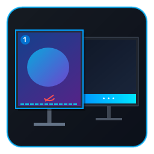

<p align="center">
  
</p>

# YCHTTOPYMIW11
### You Can Hide The Taskbar On Your Primary Monitor In Windows 11

<p align="center">
  <b>Dil / Language:</b>
  <a href="README.tr.md">🇹🇷 Türkçe</a> |
  <a href="README.md">🇬🇧 English</a>
</p>

---

[-blue.svg)](https://microsoft.com/windows)
[](https://dotnet.microsoft.com/)
[]()
[]()
[]()

**GitHub Deposu:** `you-can-hide-the-taskbar-on-your-primary-monitor-in-windows-11`

**YCHTTOPYMIW11**, Windows 11 işletim sisteminde çoklu monitör kullanan kullanıcılar için geliştirilmiş, özellikle ana monitörde veya istenilen herhangi bir ekranda görev çubuğunu fare kenar tetikleyicisi olmaksızın kalıcı olarak gizleyen ve masaüstü çalışma alanını tam ekrana genişleten yerel bir Windows masaüstü aracıdır.

Modern C# / .NET 8.0 LTS ve yerel Win32 API'leri üzerine inşa edilmiştir.

---

## 1. Temel Özellikler

- **Bağımsız Görev Çubuğu İlkeleri**: Her ekran için ayrı ayrı ilke seçebilme:
  - **Her Zaman Görünür**: Standart Windows davranışı (görev çubuğu ekranda sabit kalır).
  - **Kalıcı Olarak Gizli**: Görev çubuğunu tamamen gizler; fare imleci ekranın alt kenarına getirilse bile görev çubuğunun açılmasını, kaymasını veya anlık yanıp sönmesini engeller.
- **Masaüstü Çalışma Alanı (Work Area) Otomatik Genişletme**:
  - Görev çubuğu gizlendiğinde Windows'un altta rezerve ettiği alanı serbest bırakır.
  - Pencereler büyütüldüğünde (maximize) ekranın en altına kadar uzanır; alt kenarda hiçbir siyah/boş alan kalmaz.
  - Masaüstü simgelerinin alt alana serbestçe yerleşmesine imkan tanır.
  - Mevcut masaüstü simge dizilimini bozmaz veya sıfırlamaz.
- **Modern Windows 11 Sekmeli Arayüz (Tabs)**:
  - **Görev Çubukları Sekmesi**: Sade monitör kartları, anlık çözünürlük, DPI, mevcut görev çubuğu durumu ve tek tıkla ilke seçimi.
  - **Uygulama ve Kurtarma Ayarları Sekmesi**: Başlangıç, Explorer kurtarma ve detaylı tanılama seçenekleri.
  - **İnteraktif Akordeon Logo & Başlık**: Başlık alanında `YCHTTOPYMIW11` kısaltması ve üzerine fare getirildiğinde harflerin birbirini iterek açıldığı akıcı kinetik tipografi animasyonu.
- **Otomatik Kurtarma ve Olay Takibi**:
  - **Explorer Yeniden Başlatma**: Windows Gezgini çöktüğünde veya yeniden başlatıldığında (`TaskbarCreated`), ilkeleri otomatik olarak tekrar uygular.
  - **Ekran Düzeni Değişiklikleri**: Monitör takılıp çıkarıldığında, çözünürlük veya DPI değiştiğinde (`WM_DISPLAYCHANGE`), sistem durumunu otomatik algılar ve günceller.
  - Sıfır yoklama döngüsü (Zero polling loops) — tamamen olay güdümlü Win32 mimarisi.
- **Güvenli Geri Alma (Safe Rollback)**:
  - Tek tıklamayla Windows varsayılan ayarlarına dönebilme.
  - Uygulama kapatıldığında veya acil durumlarda orijinal çalışma alanını ve görev çubuğu görünürlüğünü eksiksiz geri yükleme.

---

## 2. Sistem Gereksinimleri

- **İşletim Sistemi**: Windows 11 (Tüm 64-bit sürümler)
- **Geliştirme / Derleme İçin**: .NET 8.0 SDK (x64)
- **Çalıştırma İçin**: .NET 8.0 Desktop Runtime (veya `publish` ile üretilen tek dosya self-contained paket için hiçbir ek kurulum gerekmez)
- **Ekran**: 2 veya daha fazla fiziksel / sanal monitör

---

## 3. Derleme ve Dağıtım (`build.cmd`)

Projeyi derlemek, test etmek, temizlemek ve dağıtım paketini oluşturmak için kök dizindeki **`build.cmd`** betiği kullanılır. Betik, sistemde yüklü .NET 8.0 SDK'sını otomatik olarak algılar.

### Kullanılabilir Komutlar:

```cmd
REM 1. Debug Modunda Derleme
build.cmd

REM 2. Release Modunda Optimize Derleme
build.cmd release

REM 3. Tüm xUnit Birim Testlerini Çalıştırma
build.cmd test

REM 4. Bağımsız Tek Dosya (.exe) Yayınlama (Publish)
build.cmd publish

REM 5. Tüm Geçici Çıktıları ve Önbellekleri Temizleme
build.cmd clean
```

### Bağımsız Yayın (Publish) Detayları:
`build.cmd publish` komutunu çalıştırdığınızda:
- .NET Runtime kurulu olmayan bilgisayarlarda doğrudan çift tıklanarak çalışabilen tek dosya (`publish\YCHTTOPYMIW11.exe`) üretilir.
- Çıktı dizini: `publish\YCHTTOPYMIW11.exe`
- Derleme paketinde gereksiz tüm geçici dosyalar temizlenmiştir; doğrudan dağıtıma ve paylaşıma hazırdır.

---

## 4. Kullanım Kılavuzu

1. `YCHTTOPYMIW11.exe` uygulamasını çalıştırın.
2. **Görev Çubukları** sekmesinde algılanan tüm monitörler listelenir.
3. Görev çubuğunu gizlemek istediğiniz monitör (örneğin Ana Ekran):
   - **Görev Çubuğu İlkesi** kutusundan **Kalıcı Olarak Gizli** seçeneğini seçin.
4. Görev çubuğunun kalmasını istediğiniz diğer monitör için:
   - **Her Zaman Görünür** seçeneğini koruyun.
5. Sağ alttaki **İlkeleri Uygula** butonuna tıklayın.
6. Seçilen monitörün görev çubuğu anında gizlenecek, çalışma alanı tam ekrana genişleyecek ve diğer monitördeki görev çubuğu normal şekilde çalışmaya devam edecektir.

---

## 5. Uygulama ve Kurtarma Ayarları

Uygulamanın ikinci sekmesinde sistem entegrasyonu ve dayanıklılık ayarları yer alır:

- **Windows açılışında otomatik başlat**: Uygulamayı `HKCU\Software\Microsoft\Windows\CurrentVersion\Run` altına ekleyerek açılışta arka planda devreye sokar.
- **Sistem bildirim alanında (tepside) simge durumunda başlat**: Açılışta ana pencereyi açmadan doğrudan sistem tepsisine küçülür.
- **Windows Gezgini (Explorer) yeniden başladığında görev çubuğu ilkelerini otomatik olarak yeniden uygula**: `TaskbarCreated` sinyalini dinleyerek görev çubuğunun daima istenen ilkede kalmasını sağlar.
- **Monitör bağlandığında/çıkarıldığında veya çözünürlük değiştiğinde ilkeleri otomatik uyarla**: `WM_DISPLAYCHANGE` olayında ekran düzenini günceller.
- **Detaylı Sistem Raporu**: İleri düzey kullanıcılar ve hata ayıklama için tüm Win32 pencere tanıtıcılarını (`HWND`), pencere ağacını ve ham koordinatları gösterir.

---

## 6. Acil Durum Kurtarma Kılavuzu

Görev çubuklarını ve çalışma alanlarını orijinal durumuna döndürmek için:

### Yöntem 1: Uygulama İçinden
Uygulamanın alt kısmındaki **Varsayılanları Geri Yükle** butonuna tıklayın.

### Yöntem 2: Sistem Tepsisinden
Sistem bildirim alanındaki simgeye sağ tıklayıp **Varsayılanları Geri Yükle** seçeneğini seçin.

### Yöntem 3: PowerShell ile Acil Kurtarma
Uygulama kapalıyken acil geri alma gerekirse aşağıdaki komutu PowerShell'de çalıştırabilirsiniz:

```powershell
Add-Type -TypeDefinition @'
using System;
using System.Runtime.InteropServices;
public class Restorer {
    [DllImport("user32.dll")] public static extern IntPtr FindWindow(string c, string t);
    [DllImport("user32.dll")] public static extern bool ShowWindow(IntPtr h, int c);
    [DllImport("user32.dll")] public static extern bool SetWindowPos(IntPtr h, IntPtr a, int x, int y, int cx, int cy, uint f);
    public static void Show() {
        IntPtr p = FindWindow("Shell_TrayWnd", null);
        if (p != IntPtr.Zero) { ShowWindow(p, 5); SetWindowPos(p, IntPtr.Zero, 0, 0, 0, 0, 0x0001|0x0002|0x0040); }
        IntPtr s = FindWindow("Shell_SecondaryTrayWnd", null);
        if (s != IntPtr.Zero) { ShowWindow(s, 5); SetWindowPos(s, IntPtr.Zero, 0, 0, 0, 0, 0x0001|0x0002|0x0040); }
    }
}
'@
[Restorer]::Show()
```

---

## 7. Proje Belgeleri

- [Teknik Araştırma ve Win32 İncelemesi](docs/technical-research.md)
- [Mimari Tasarım Belgesi](docs/architecture.md)
- [Donanım Test Planı](docs/testing.md)
- [Sistem Tanılama Raporu (Host Çıktısı)](docs/diagnostic-system-report.md)

---

## 8. Lisans

Bu proje [MIT Lisansı](LICENSE) altında lisanslanmıştır. Açık kaynaklıdır ve özgürce çatallanabilir (fork).

