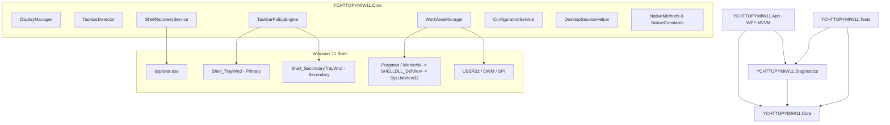

# Architecture Documentation — YCHTTOPYMIW11

## 1. System Overview

**YCHTTOPYMIW11** is a specialized Windows 11 utility engineered to manage multi-monitor display environments. It provides per-monitor Windows taskbar visibility policies while solving the shell desktop work area problem so that desktop icons and maximized application windows can fully occupy previously reserved screen real estate.

The application is structured into four distinct layers:

1. **YCHTTOPYMIW11.Core**: Low-level Win32 P/Invoke declarations, session abstractions, monitor and window discovery, work-area management, taskbar policy enforcement, shell event recovery, and configuration persistence.
2. **YCHTTOPYMIW11.Diagnostics**: Diagnostic state snapshots, condition evaluation (Conditions A, B, C, D), metric comparisons, and report generation.
3. **YCHTTOPYMIW11.App**: Polished Windows 11 WPF application adhering to MVVM with dependency injection, Turkish user interface, system tray integration, and startup persistence.
4. **YCHTTOPYMIW11.Tests**: Automated xUnit test suite verifying geometry math, configuration isolation, serialization/deserialization, live diagnostic collection, and report formatting.

---

## 2. High-Level Component Architecture

---

## 3. Core Service Components & Design Patterns

### 3.1 DesktopSessionHelper (`WinSta0\Default` Isolation Bridge)
- **Problem**: When tools or background processes run in non-interactive thread desktops or isolated execution contexts, standard calls to `FindWindow` or `EnumWindows` fail to resolve shell windows.
- **Solution**: `DesktopSessionHelper` executes actions on a clean MTA thread that explicitly connects to `OpenDesktop("Default", ...)` and invokes `SetThreadDesktop`. This ensures 100% deterministic access to `Shell_TrayWnd`, `Shell_SecondaryTrayWnd`, and `Progman`.

### 3.2 DisplayManager (`IDisplayManager`)
- Enumerates all physical and virtual displays using `EnumDisplayMonitors` and `GetMonitorInfo`.
- Queries monitor bounds, work areas, primary flags, and Per-Monitor V2 DPI scaling (`GetDpiForMonitor`).
- Provides clean lookups by handle (`HMONITOR`) and device name (e.g. `\\.\DISPLAY1`).

### 3.3 TaskbarDetector (`ITaskbarDetector`)
- Discovers the primary taskbar (`Shell_TrayWnd`) and all secondary taskbars (`Shell_SecondaryTrayWnd`).
- Correlates each taskbar HWND to its owning monitor using `MonitorFromWindow(hWnd, MONITOR_DEFAULTTONEAREST)`.
- Captures window styles, extended styles, and bounding coordinates.

### 3.4 WorkAreaManager (`IWorkAreaManager`)
- **Key Discovery**: Calling `SystemParametersInfo(SPI_SETWORKAREA, ...)` with `SPIF_SENDCHANGE` causes Explorer's `Shell_TrayWnd` to receive `WM_SETTINGCHANGE`, leading its internal AppBar handler to immediately reset the work area back to 1392 pixels.
- **Solution**:
  1. Call `SystemParametersInfoSet(SPI_SETWORKAREA, 0, ref fullBounds, 0)` with `fWinIni = 0`.
  2. Send a targeted `WM_SETTINGCHANGE` message directly to `Progman` and `SHELLDLL_DefView` via `SendMessageTimeout` using the `"WorkArea"` parameter.
  3. This bypasses `Shell_TrayWnd`, preventing the rollback, while alerting the desktop view to adjust its icon boundary.
- Caches original work areas in a thread-safe map to ensure clean rollback.

### 3.5 TaskbarPolicyEngine (`ITaskbarPolicyEngine`)
Supports three distinct policies per monitor:
1. **AlwaysVisible**:
   - Ensures the taskbar window is placed at its recorded bounds.
   - Calls `ShowWindow(hWnd, SW_SHOW)`.
   - Restores the original work area reservation.
2. **PermanentlyHidden**:
   - Calls `ShowWindow(hWnd, SW_HIDE)`.
   - Repositions the window off-screen at `(0, 30000)` using `SetWindowPos` with `SWP_HIDEWINDOW | SWP_NOACTIVATE | SWP_NOSIZE | SWP_NOZORDER`.
   - This eliminates edge-hover detection (the window is not in the hit-test tree) and prevents transient visual artifacts.
   - Triggers work area expansion if requested.
3. **AutoHidden**:
   - Standard shell auto-hiding mode.

### 3.6 ShellRecoveryService (`IShellRecoveryService`)
- Operates a dedicated background message loop using a Win32 message-only window (`HWND_MESSAGE`).
- Listens for:
  - `TaskbarCreated` (`RegisterWindowMessage("TaskbarCreated")`): Triggered when Explorer restarts.
  - `WM_DISPLAYCHANGE`: Triggered when monitor arrangement, resolution, or topology changes.
  - `WM_DPICHANGED`: Triggered on DPI scaling shifts.
- Fires decoupled asynchronous events to allow `MainViewModel` and `TaskbarPolicyEngine` to re-apply policies without tight polling loops.

### 3.7 ConfigurationService (`IConfigurationService`)
- Manages versioned JSON configuration in `%LOCALAPPDATA%\YCHTTOPYMIW11\config.json`.
- Automatically maintains a fallback backup file (`config.backup.json`) to prevent corruption during system crashes or abrupt shutdowns.

---

## 4. MVVM Architecture in YCHTTOPYMIW11.App

- **IoC Container**: `Microsoft.Extensions.DependencyInjection` configured in `App.xaml.cs`.
- **ViewModels**:
  - `ViewModelBase`: Implements `INotifyPropertyChanged` with `SetField`.
  - `RelayCommand`: Thread-safe `ICommand` implementation with `CanExecute` hooks.
  - `MonitorCardViewModel`: Encapsulates per-monitor metrics, taskbar status, policy selection, and work area toggles.
  - `MainViewModel`: Coordinates the monitor collection, policy application, defaults restoration, diagnostic generation, settings toggles, and shell recovery events.
- **Views**:
  - `MainWindow.xaml`: Windows 11 Fluent dark theme, responsive grid cards, expander settings, status bar, and modal overlay for diagnostic inspection.
  - `System.Windows.Forms.NotifyIcon`: System tray background persistence with context menu.

---

## 5. Known Limitations & Technical Constraints

1. **Secondary Monitor Work Area Updates**:
   Windows 11 manages secondary monitor taskbars through internal Explorer logic rather than traditional `SHAppBarMessage` registrations. While hiding `Shell_SecondaryTrayWnd` allows desktop windows to span the bottom edge, Windows Explorer's desktop icon view on secondary monitors queries internal shell caches.
2. **Desktop Icon Grid Snap Step**:
   The desktop icon layout (`SysListView32`) employs fixed grid cell sizes (measured at 75x99 pixels). When "Align icons to grid" is active, Explorer snaps icons to the lowest full cell that fits within `rcWork.Bottom`. Removing the 48-pixel reservation allows smaller icon arrangements or disabled-grid icons to reach the true monitor bottom, but large 99-pixel grid cells require sufficient remaining vertical clearance.
3. **Explorer Internal Hooking Boundaries**:
   YCHTTOPYMIW11 purposefully avoids DLL injection or in-memory code patching of `explorer.exe` to preserve system stability and avoid triggering anti-cheat or security endpoint protections. All actions use sanctioned Win32 APIs, message timeouts, and window placement techniques.

